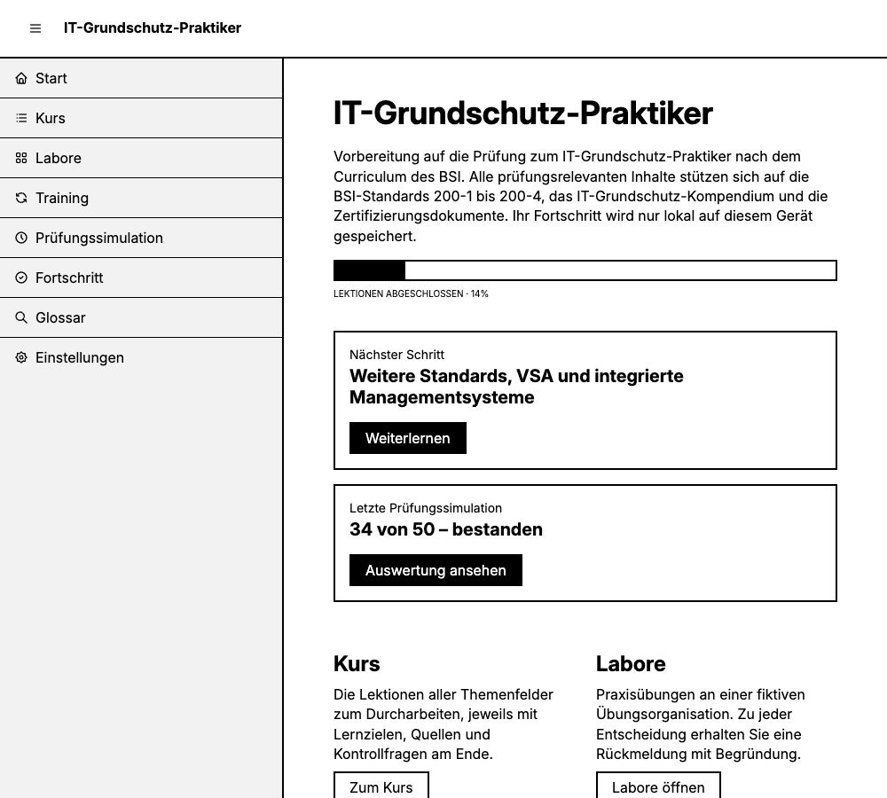
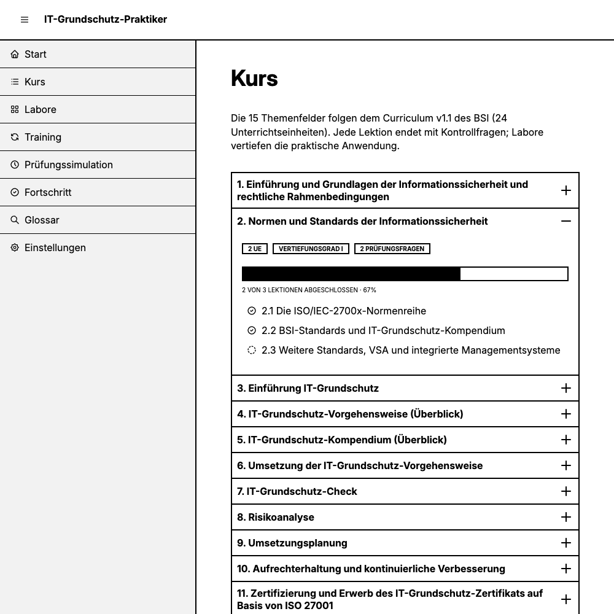
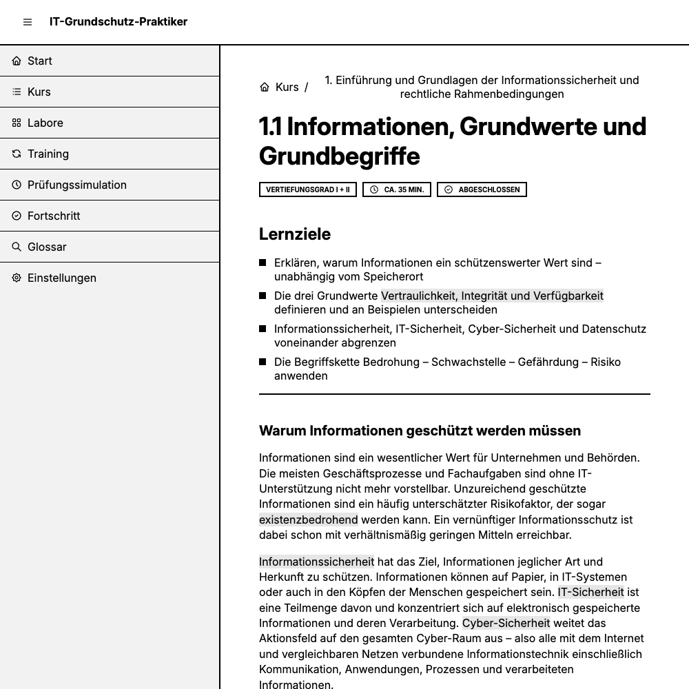
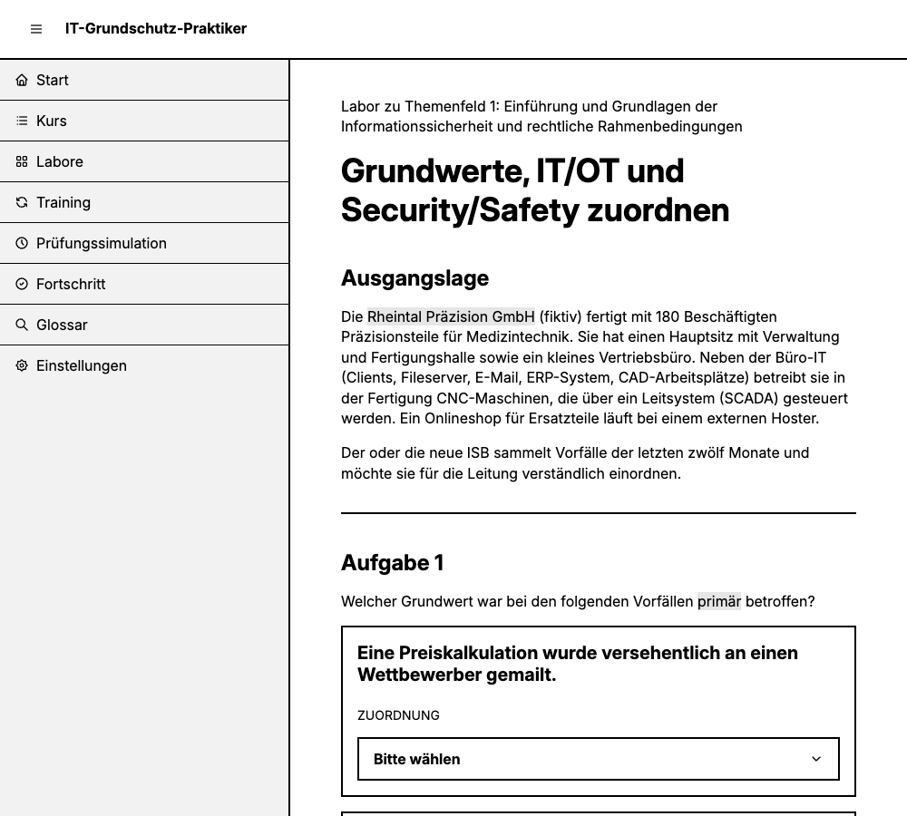
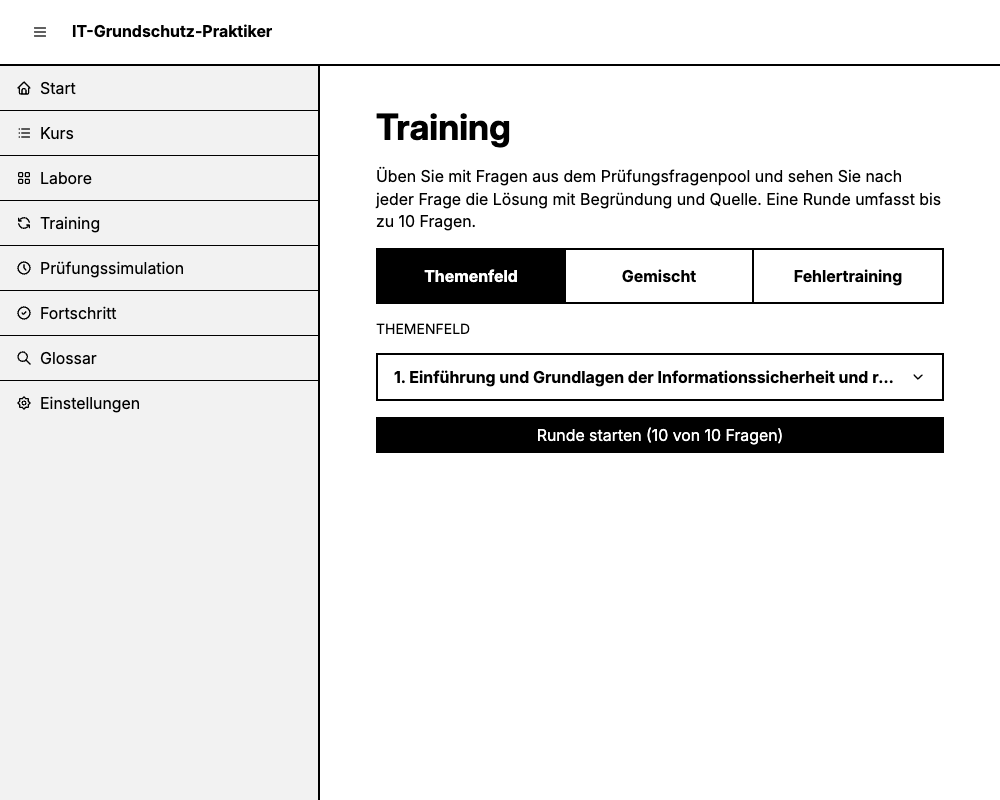
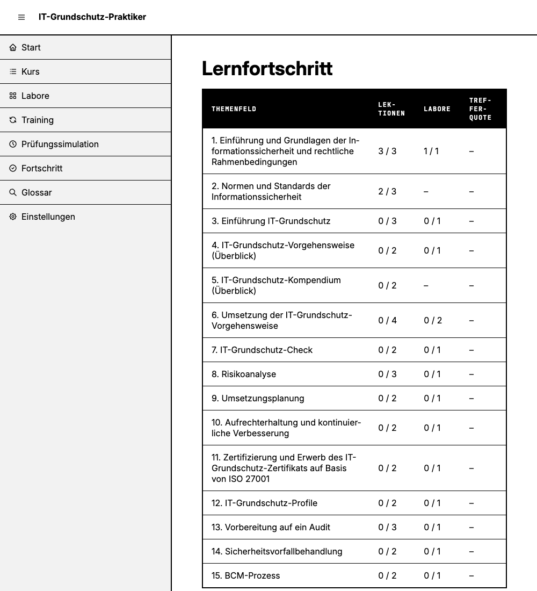
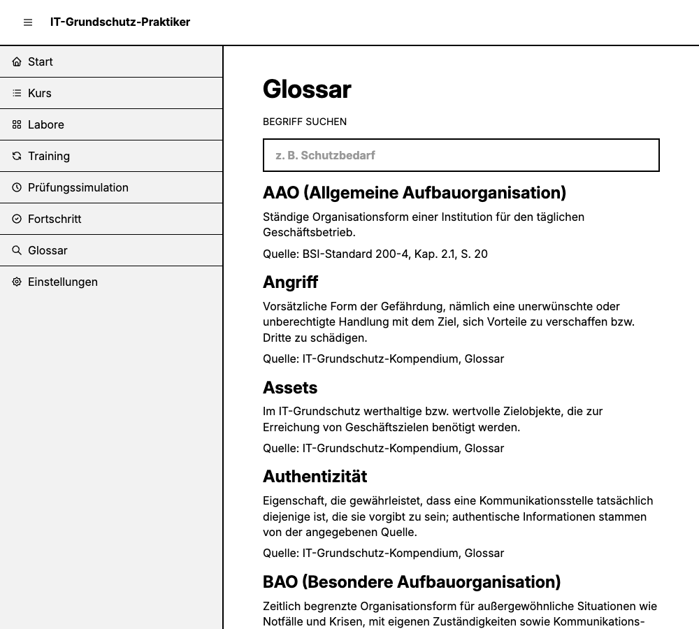
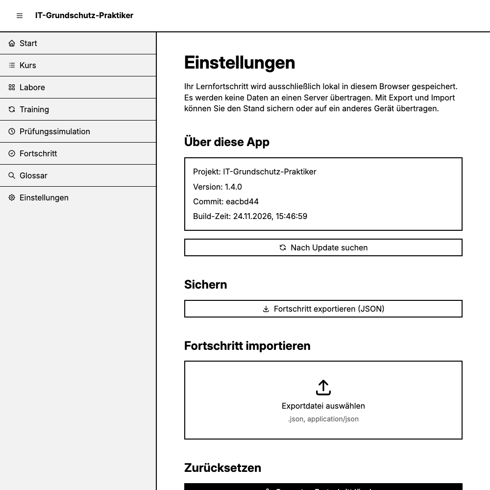
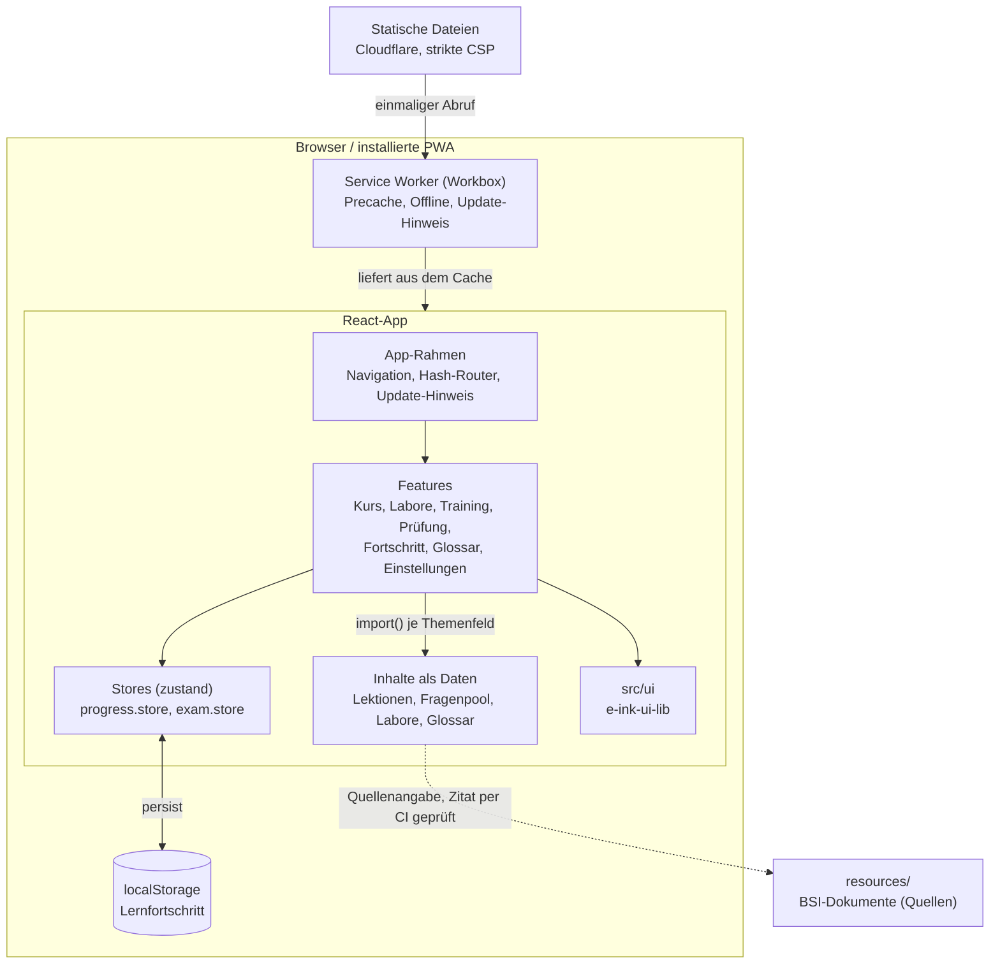
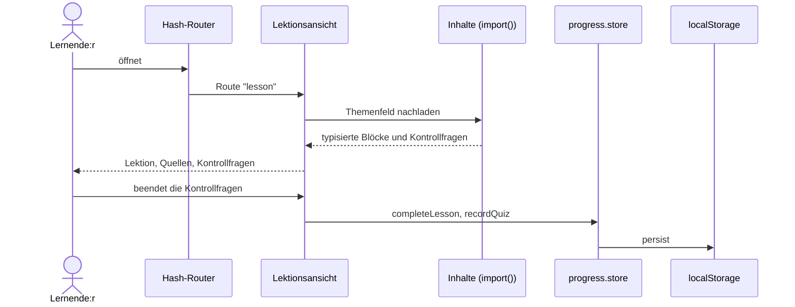

# IT-Grundschutz-Praktiker – Vorbereitungskurs

Progressive Web App zur Vorbereitung auf die Prüfung zum **IT-Grundschutz-Praktiker** des Bundesamts für Sicherheit in der Informationstechnik (BSI). Der Kurs ist vollständig auf Deutsch, für E-Ink-Displays optimiert und funktioniert nach dem ersten Aufruf auch offline. Der Lernfortschritt bleibt ausschließlich auf dem eigenen Gerät.

> Dies ist ein privates Lernprojekt und kein offizielles Angebot des BSI. Maßgeblich für die Prüfung sind allein die Dokumente des BSI und die Prüfungsbedingungen der Schulungsanbieter.

## Inhalt

- [Security by Design](#security-by-design)
- [Funktionen](#funktionen)
- [Bedienung](#bedienung)
- [Screenshots](#screenshots)
- [Didaktisches Konzept](#didaktisches-konzept)
- [Quelldokumente](#quelldokumente)
- [Technologien](#technologien)
- [Architektur](#architektur)
- [Entwicklung](#entwicklung)
- [Weitere Dokumentation](#weitere-dokumentation)
- [Lizenz](#lizenz)

## Security by Design

Die Anwendung ist von Anfang an auf Sicherheit ausgelegt, von der lokalen Entwicklungsumgebung bis zur Auslieferung. Abhängigkeiten sind auf exakte Versionen festgelegt, werden mit `npm ci` und deaktivierten Lifecycle-Skripten installiert und per `npm audit`, Signaturprüfung und CodeQL kontrolliert; GitHub Actions sind auf Commit-SHAs gepinnt. Ausgeliefert werden nur statische Dateien über Cloudflare, abgesichert durch eine strikte Content-Security-Policy (nur eigener Ursprung, kein `eval`, Trusted Types) und weitere Sicherheits-Header. Es gibt kein Backend, keine Fremd-Origins und keine Übertragung von Nutzerdaten; der Lernfortschritt bleibt lokal und wird beim Laden validiert. Details: [SECURITY.md](SECURITY.md) und die [ADRs](docs/decisions).

## Funktionen

| Bereich | Umfang |
|---|---|
| **Kurs** | 37 Lektionen zu den 15 Themenfeldern des Curriculums v1.1 (24 UE), mit Lernzielen, Merke-Kästen, Beispielen, Quellenangaben und 116 Kontrollfragen |
| **Labore** | 14 interaktive Übungen an der fiktiven „Rheintal Präzision GmbH“: Strukturanalyse, Schutzbedarf, Modellierung, IT-Grundschutz-Check, Risikoanalyse, Umsetzungsplanung, Audit, Vorfallbehandlung, BCM u. a. |
| **Training** | Fragen aus dem Prüfungspool mit sofortiger Rückmeldung – nach Themenfeld, gemischt oder als Fehlertraining |
| **Prüfungssimulation** | 50 Fragen, 60 Minuten, Verteilung nach Tabelle 2 der Prüfungsbedingungen, bestanden ab 30 Punkten |
| **Fortschritt** | Lektionen, Labore, Trefferquote je Themenfeld, Verlauf aller Simulationen |
| **Glossar** | 41 zentrale Begriffe mit Quellenangabe und Suche |
| **Einstellungen** | Fortschritt als JSON exportieren, importieren oder zurücksetzen |

## Bedienung

### App öffnen und installieren

1. Die App im Browser öffnen (lokal: `npm run dev`, siehe [Entwicklung](#entwicklung)).
2. Optional über das Browsermenü „Zum Startbildschirm hinzufügen“ bzw. „App installieren“ wählen. Danach läuft der Kurs auch ohne Internetverbindung.
3. Gibt es eine neue Version, erscheint ein Hinweis mit der Schaltfläche **Neu laden**.

### Empfohlener Lernweg

1. **Kurs**: Themenfelder der Reihe nach bearbeiten. Jede Lektion endet mit Kontrollfragen; eine Lektion gilt als abgeschlossen, sobald die Kontrollfragen beendet sind oder sie als gelesen markiert wurde.
2. **Labor**: Nach den Lektionen eines Themenfelds das zugehörige Labor lösen. Jede Aufgabe wird einzeln ausgewertet und erklärt.
3. **Training**: Themenfelder gezielt üben. Das **Fehlertraining** wiederholt nur Fragen, die zuletzt falsch beantwortet wurden.
4. **Prüfungssimulation**: Unter Prüfungsbedingungen testen. Weitere Simulationen ziehen bevorzugt Fragen, die noch nicht drankamen.
5. **Fortschritt**: Schwache Themenfelder erkennen und gezielt wiederholen.

### Regeln der Prüfungssimulation

Die Simulation folgt den Prüfungsbedingungen v2.2 (Details in [ADR 0015](docs/decisions/0015-exam-simulation-rules.md)):

- 50 Fragen mit je vier Aussagen; null bis vier Aussagen können richtig sein.
- Ein Punkt gibt es nur, wenn alle Aussagen richtig angekreuzt bzw. nicht angekreuzt sind. Kein Kreuz bedeutet „keine Aussage richtig“.
- Bestanden ab 30 von 50 Punkten (60 %).
- Die Zeit läuft nach der Uhr weiter, auch wenn die App geschlossen wird. Nach 60 Minuten wird automatisch abgegeben.
- Während der Prüfung gibt es keine Rückmeldung. Fragen lassen sich markieren und in beliebiger Reihenfolge bearbeiten.
- Die Auswertung zeigt das Ergebnis je Themenfeld und zu jeder Frage die Erklärung mit Quelle.

### Fortschritt sichern

Alle Daten liegen im `localStorage` des Browsers. Wer den Browserspeicher löscht oder das Gerät wechselt, sollte vorher unter **Einstellungen → Exportieren** eine JSON-Datei sichern und sie auf dem neuen Gerät wieder importieren. Importierte Dateien werden vor der Übernahme geprüft.

## Screenshots

Die Ansichten zeigen die App mit Beispielfortschritt im E-Ink-tauglichen Schwarz-Weiß-Design.

| Start | Kurs |
|---|---|
| [](screenshots/start.png) | [](screenshots/kurs.png) |

| Lektion | Labor |
|---|---|
| [](screenshots/lektion.png) | [](screenshots/labor.png) |

| Training | Fortschritt |
|---|---|
| [](screenshots/training.png) | [](screenshots/fortschritt.png) |

| Glossar | Einstellungen |
|---|---|
| [](screenshots/glossar.png) | [](screenshots/einstellungen.png) |

## Didaktisches Konzept

- **Curriculum als Gerüst**: Jedes Themenfeld des Curriculums hat eigene Lektionen; der Vertiefungsgrad (I = Kennen, II = Anwenden) bestimmt die Tiefe. Die Zuordnung steht in [docs/curriculum-coverage.md](docs/curriculum-coverage.md).
- **Nachvollziehbare Quellen**: Jede prüfungsrelevante Aussage, jede Frage und jedes Labor verweist auf Dokument, Kapitel und Seite in `resources/` ([ADR 0014](docs/decisions/0014-source-policy-and-praxis-2026.md)).
- **Getrennte Fragenpools**: Kontrollfragen in den Lektionen dienen dem Verständnis. Training und Simulation nutzen einen eigenen Pool mit 184 Fragen, davon 75 % Basis- und 25 % Expertenfragen, wie es die Prüfungsbedingungen vorsehen.
- **Praxis 2026**: Aktuelle Entwicklungen (z. B. NIS-2-Pflichten, der neue digitale IT-Grundschutz, C5) stehen in eigenen Kästen mit dem Hinweis „nicht prüfungsrelevant“, öffentlicher Quelle und Datum. Sie fließen nie in Fragen ein.
- **Ergänzungen außerhalb der Quellen**: Begriffe, die das Curriculum nennt, die BSI-Dokumente aber nicht erläutern (z. B. HV-Benchmark, Audit-Arten), sind ausdrücklich als Ergänzung gekennzeichnet und werden nicht abgefragt.
- **Lernen durch Anwenden**: Die Labore spielen die Schritte der IT-Grundschutz-Methodik an einer durchgängigen Übungsorganisation durch.
- **E-Ink-tauglich**: Keine Animationen, hoher Kontrast, der Prüfungs-Timer aktualisiert sich nur alle 15 Sekunden.

## Quelldokumente

Alle Dokumente stammen vom BSI und liegen in [`resources/`](resources):

| Dokument | Version | Datei |
|---|---|---|
| Curriculum IT-Grundschutz-Praktiker und -Berater | 1.1 (24.09.2024) | [curriculum_1_1.pdf](resources/curriculum_1_1.pdf) |
| Fragen und Antworten zum Schulungskonzept | 1.1 (24.09.2024) | [faq_curiculum.pdf](resources/faq_curiculum.pdf) |
| Prüfungsbedingungen IT-Grundschutz-Praktiker | 2.2 (23.06.2026) | [pruefungsbedingungen_fuer_den_it_gs_praktiker.pdf](resources/pruefungsbedingungen_fuer_den_it_gs_praktiker.pdf) |
| IT-Grundschutz-Kompendium | Edition 2023 | [IT_Grundschutz_Kompendium_Edition2023.pdf](resources/IT_Grundschutz_Kompendium_Edition2023.pdf) |
| BSI-Standard 200-1: Managementsysteme für Informationssicherheit | 1.0 (10/2017) | [standard_200_1.pdf](resources/standard_200_1.pdf) |
| BSI-Standard 200-2: IT-Grundschutz-Methodik | 1.0 (10/2017) | [standard_200_2.pdf](resources/standard_200_2.pdf) |
| BSI-Standard 200-3: Risikoanalyse auf der Basis von IT-Grundschutz | 1.0 (10/2017) | [standard_200_3.pdf](resources/standard_200_3.pdf) |
| BSI-Standard 200-4: Business Continuity Management | 2023 | [standard_200_4.pdf](resources/standard_200_4.pdf) |
| Zertifizierungsschema ISO 27001 auf Basis IT-Grundschutz | 2.2 | [zertifizierungsschema.pdf](resources/zertifizierungsschema.pdf) |
| Auditierungsschema ISO 27001 auf Basis IT-Grundschutz | 2.5 | [auditierungsschema.pdf](resources/auditierungsschema.pdf) |
| Hinweise zur Bereitstellung der Referenzdokumente | 2.1 | [hinweise_referenzdokumente.pdf](resources/hinweise_referenzdokumente.pdf) |
| Leitfaden zur Basis-Absicherung | 10/2017 | [leitfaden_basis_absicherung.pdf](resources/leitfaden_basis_absicherung.pdf) |
| IT-Grundschutz-Profile – Strukturbeschreibung | 1.0 (28.09.2018) | [it_grundschutz_profil_strukturbeschreibung.pdf](resources/it_grundschutz_profil_strukturbeschreibung.pdf) |

Aktuelle Fassungen gibt es auf der [IT-Grundschutz-Seite des BSI](https://www.bsi.bund.de/DE/Themen/Unternehmen-und-Organisationen/Standards-und-Zertifizierung/IT-Grundschutz/it-grundschutz_node.html). Herkunft (Download-URL, Abrufdatum) und Inhalt jedes Dokuments sind in [resources/RESSOURCES.md](resources/RESSOURCES.md) beschrieben. Die Registry der zitierfähigen Dokumente ist [`src/content/sources.constants.ts`](src/content/sources.constants.ts).

## Technologien

| Bereich | Technologie | Zweck |
|---|---|---|
| Sprache | TypeScript 6 (strict) | Typisierte Inhalte, Komponenten und Logik |
| UI-Framework | React 19 | Oberfläche |
| UI-Bibliothek | [`e-ink-ui-lib`](https://github.com/AlexisRoe/e-ink-ui-lib) | Alle Komponenten, Typografie und Design-Tokens für E-Ink-Displays |
| Build | Vite 8 | Entwicklungsserver und Produktions-Build |
| Offline / PWA | vite-plugin-pwa 2 (Workbox) | Service Worker, Precaching, Update-Hinweis, Installierbarkeit |
| Zustand | zustand 5 mit `persist` | Lernfortschritt und laufende Prüfung in `localStorage` |
| Routing | Eigener Hash-Router (`useHashRoute` der UI-Bibliothek) | Navigation ohne Router-Bibliothek |
| Tests | Vitest 5, Testing Library, jsdom | Komponenten-, Logik- und Integritätstests mit Coverage |
| Lint / Format | Biome 2 | Einheitlicher Code-Stil |
| Sicherheit | Strikte Content-Security-Policy, Trusted Types, `npm audit` | Keine Fremd-Origins, kein `eval`, geprüfte Abhängigkeiten |
| Deployment | Cloudflare (Wrangler), GitHub Actions | Automatisches Ausliefern von `main` |

Alle Versionen sind exakt in [`package.json`](package.json) festgelegt. Gründe für einzelne Entscheidungen stehen in den [ADRs](docs/decisions).

## Architektur

### Überblick



Die App besteht nur aus statischen Dateien. Nach dem ersten Aufruf liefert der Service Worker alles aus dem Cache; es gibt kein Backend und keine Netzwerkanfragen mit Nutzerdaten.

### Datenfluss einer Lektion



### Verzeichnisse

```
src/
  app/          App-Rahmen, Navigation, Routen (#/kurs, #/labor, #/training, #/pruefung, …)
  components/   App-weite Komponenten (RichText, Loading, Quellenliste, Update-Hinweis)
  config/       Stellgrößen, z. B. exam.config.ts (50 Fragen, 60 Min., 60 %)
  content/      Kursinhalte und Datenmodell
    course.types.ts         Typen für Lektionen, Blöcke, Fragen, Labore
    topics.constants.ts     15 Themenfelder mit UE, Vertiefungsgrad, Prüfungsanteil
    sources.constants.ts    Registry der Quelldokumente
    topics/*.content.ts     Lektionen und Kontrollfragen je Themenfeld
    questions/*.questions.ts  Prüfungsfragenpool je Themenfeld
    labs/*.lab.ts           Labore
    glossary.content.ts     Glossar
  features/     course, quiz, labs, practice, exam, progress, glossary
  hooks/        useHashRoute (typed über dem Router der UI-Bibliothek), useCourse
  stores/       progress.store (persistiert), exam.store (laufende Prüfung), Selektoren
  ui/           einziger Import-Punkt für e-ink-ui-lib
resources/      BSI-Dokumente (PDF)
docs/           Curriculum-Abdeckung und Architekturentscheidungen (ADRs)
```

### Zentrale Konzepte

- **Inhalte sind Daten, kein HTML**: Lektionen bestehen aus typisierten Blöcken (`heading`, `paragraph`, `list`, `table`, `definition`, `callout`, `example`, `praxis`). `content-block.component.tsx` bildet sie auf Bibliothekskomponenten ab; Hervorhebungen (`**fett**`) werden ohne `dangerouslySetInnerHTML` gerendert.
- **Frage-Modell**: Jede Frage hat genau vier Aussagen mit `correct`-Flag, eine Erklärung, ein Niveau (`basis`/`experte`) und eine Quelle. Dieselbe Fragekarte dient Kontrollfragen, Training und Simulation.
- **Prüfungslogik als reine Funktionen** (`features/exam/exam.utils.ts`): Ziehen nach Tabelle 2, Alles-oder-nichts-Wertung und Auswertung sind ohne UI testbar; der Zufallsgenerator ist injizierbar.
- **Labore als Daten**: Eine generische Engine kennt zwei Aufgabentypen – `classify` (Elemente Kategorien zuordnen) und `order` (Reihenfolge herstellen).
- **Integritätstests** (`content.test.ts`): eindeutige IDs, genau vier Aussagen, gültige Quellen, Mindestanzahl Fragen je Themenfeld, Basis-Anteil 70–80 %, Praxis-Kästen nur mit HTTPS-Quelle.
- **Lokale Daten bleiben lokal**: keine Netzwerkanfragen außer den eigenen statischen Dateien, keine Fremd-Origins (siehe [SECURITY.md](SECURITY.md)).

## Entwicklung

Voraussetzung: Node.js in der Version aus `.nvmrc`.

```sh
nvm use
npm ci            # Installation (Lifecycle-Skripte deaktiviert, ADR 0006)
npm run dev       # Entwicklungsserver
npm run build     # Produktions-Build nach dist/
npm run preview   # Build lokal ausliefern (inkl. Service Worker)
npm test          # Tests
npm run check     # Lint, Typecheck, Tests mit Coverage, Build
npm run security  # npm audit (ab „high“) und Signaturprüfung
```

### Inhalte ergänzen

1. Lektion in `src/content/topics/NN-*.content.ts` ergänzen; jeder Block und jede Frage braucht eine `source` aus `sources.constants.ts`.
2. Prüfungsfragen in `src/content/questions/NN-*.questions.ts`: genau vier Aussagen, eindeutige ID, Niveau `basis` oder `experte`.
3. Labore als `src/content/labs/NN-*.lab.ts` anlegen; sie werden automatisch gefunden.
4. `npm run check` ausführen – die Integritätstests melden fehlende Quellen, doppelte IDs oder zu kleine Pools.

Konventionen für Dateinamen, UI und Sicherheit stehen in [CLAUDE.md](CLAUDE.md).

## Weitere Dokumentation

- [Abdeckung des Curriculums](docs/curriculum-coverage.md)
- Architekturentscheidungen:
  - [0003 Typografie nur aus e-ink-ui-lib](docs/decisions/0003-ui-lib-only-typography.md)
  - [0006 npm-Lifecycle-Skripte deaktiviert](docs/decisions/0006-ignore-scripts.md)
  - [0010 Eingebettete Schriften beim Build auslagern (ersetzt durch e-ink-ui-lib 1.4.0)](docs/decisions/0010-extract-inline-fonts.md)
  - [0011 Hash-Routing ohne Router-Bibliothek](docs/decisions/0011-hash-router-without-dependency.md)
  - [0012 zustand mit localStorage für den Lernfortschritt](docs/decisions/0012-zustand-local-progress.md)
  - [0013 Kursinhalte als typisierte Daten](docs/decisions/0013-content-as-typed-data.md)
  - [0014 Quellenpolitik und Praxis 2026](docs/decisions/0014-source-policy-and-praxis-2026.md)
  - [0015 Regeln der Prüfungssimulation](docs/decisions/0015-exam-simulation-rules.md)
  - [0016 Moderate npm-audit-Befunde zurückgestellt](docs/decisions/0016-defer-moderate-audit-findings.md)
- [Sicherheitsrichtlinie](SECURITY.md)

## Lizenz

Der Quellcode und die selbst verfassten Kursinhalte stehen unter der [MIT-Lizenz](LICENSE) (© 2026 Alexis Roehrling).

Die PDF-Dokumente in `resources/` sind Veröffentlichungen des BSI und fallen **nicht** unter die MIT-Lizenz; es gelten die Nutzungsbedingungen des BSI. „IT-Grundschutz“ und „BSI“ sind Bezeichnungen des Bundesamts für Sicherheit in der Informationstechnik. Dieses Projekt steht in keiner Verbindung zum BSI.
